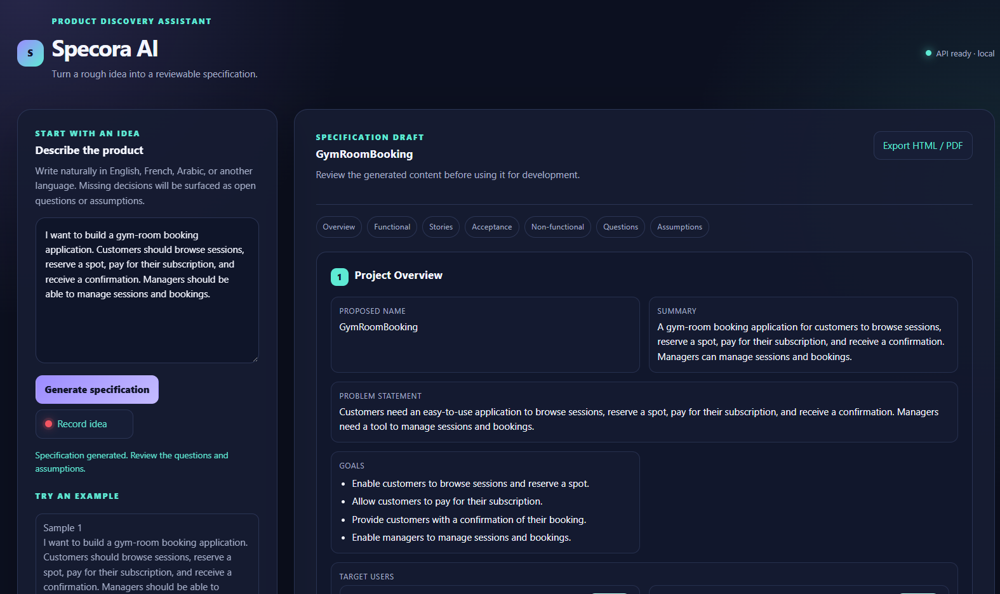
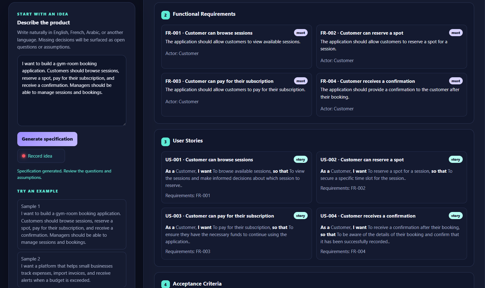

# Specora AI

> Turn a rough product idea into a reviewable, traceable software specification.

Specora AI is a local-first product discovery assistant. It transforms an
unstructured idea into a structured specification that a Product Owner,
stakeholder, or development team can review before implementation begins.

The application is deliberately human-centred: the language model proposes a
draft, while the user validates assumptions, answers open questions, edits the
content, and decides what is ready for development.

## Product preview

### From idea to a structured draft



### Traceable requirements and user stories



## Why Specora AI

Product ideas often begin as a paragraph, a conversation, or a voice note. The
hard part is turning that input into something precise enough to discuss,
challenge, test, and build.

Specora AI helps by making uncertainty visible and by keeping the links between
the most important specification elements explicit:

```text
Product idea
    ↓
Structured specification draft
    ↓
Human review and editing
    ↓
Traceable requirements, stories, and acceptance criteria
    ↓
HTML / PDF-ready export
```

## Current capabilities

- Generate a structured specification from a free-form product idea.
- Accept ideas in text or through optional voice transcription.
- Support OpenAI or an OpenAI-compatible local LLM endpoint.
- Produce seven reviewable sections in a stable order.
- Normalize identifiers into traceable prefixes: `FR`, `US`, `AC`, `NFR`, `Q`,
  and `A`.
- Preserve relationships from functional requirements to user stories and from
  user stories to acceptance criteria.
- Surface open questions and assumptions instead of hiding uncertainty.
- Export a professional HTML document that can be printed or saved as PDF.
- Continue to present generation failures as actionable errors rather than
  rendering an invalid draft.

## Specification output

Every generated draft contains the following sections:

| # | Section | Purpose |
| --- | --- | --- |
| 1 | Project Overview | Name, summary, problem, goals, and target users |
| 2 | Functional Requirements | Testable product capabilities with actors and priorities |
| 3 | User Stories | User-centred outcomes linked to requirements |
| 4 | Acceptance Criteria | Observable conditions linked to user stories |
| 5 | Non-Functional Requirements | Quality attributes such as accessibility, security, and performance |
| 6 | Open Questions | Decisions that still require clarification |
| 7 | Assumptions | Explicit inferences that require human validation |

The export template intentionally does not display the internal
`project_overview.scope.in_scope` or `project_overview.scope.out_of_scope`
fields.

## Traceability model

The application owns identifier normalization after the LLM response is
received. This protects the relationship graph even when a model returns simple
numeric IDs or inconsistent formats.

| Entity | Identifier example | Relationship |
| --- | --- | --- |
| Functional requirement | `FR-001` | A capability the product must provide |
| User story | `US-001` | References one or more functional requirements |
| Acceptance criteria group | `AC-001` | References its user story through `user_story_id` |
| Non-functional requirement | `NFR-001` | A quality or operational constraint |
| Open question | `Q-001` | A decision requiring clarification |
| Assumption | `A-001` | An explicit statement requiring review |

In the HTML/PDF-ready export, related identifiers are rendered as visible
links, so a reviewer can move between a story and its requirements or between
acceptance criteria and the story they verify.

## Architecture

Specora AI is intentionally small and modular:

```text
Browser UI
  ├── Idea input and sample prompts
  ├── Optional MediaRecorder voice input
  ├── Section-by-section specification view
  └── HTML / PDF-ready export action
       │
       ▼
FastAPI application
  ├── API boundary and request validation
  ├── Specification response shaping
  ├── LLM orchestration and validation
  ├── Speech-to-text adapter
  └── Export renderer and print stylesheet
```

### Main modules

| Path | Responsibility |
| --- | --- |
| `main.py` | FastAPI application, routes, and API request models |
| `understand.py` | Prompt, canonical JSON schema, LLM adapter, ID normalization, and relationship validation |
| `actions.py` | Response shaping and section metadata |
| `stt.py` | Optional speech-to-text adapter |
| `exports.py` | Safe HTML rendering for the export template |
| `static/index.html` | Browser interface and application styling |
| `static/app.js` | Generation, voice recording, review rendering, and export actions |
| `static/specification-export.html` | Professional HTML/PDF-ready document template |
| `test_exports.py` | Deterministic export and traceability checks |

## Run locally

### 1. Install dependencies

Create a virtual environment and install the project requirements:

```powershell
python -m venv .venv
.\.venv\Scripts\Activate.ps1
pip install -r requirements.txt
```

### 2. Configure the application

Copy the example environment file:

```powershell
Copy-Item .env.example .env
```

For cloud generation, set `OPENAI_API_KEY` and keep:

```env
UNDERSTAND_BACKEND=openai
```

For a local OpenAI-compatible LLM server, use:

```env
UNDERSTAND_BACKEND=local
LOCAL_LLM_BASE_URL=http://localhost:8080/v1
LOCAL_LLM_MODEL=qwen2.5-1.5b-instruct
```

The local server must be running before a generation request is made.

### 3. Start Specora AI

```powershell
uvicorn main:app --reload
```

Open [http://127.0.0.1:8000](http://127.0.0.1:8000) in a browser.

## Voice input

Voice input is an optional input adapter, not a separate product workflow.

1. Select **Record idea**.
2. Allow microphone access in the browser.
3. Speak the product idea.
4. Select **Stop recording**.
5. Review the transcription in the idea field.
6. Generate the specification from the reviewed text.

The transcription backend is configured independently from the understanding
backend:

```env
TRANSCRIBE_BACKEND=openai
```

For local transcription, configure `TRANSCRIBE_BACKEND=local` and the Whisper
settings in `.env.example`.

## Export

After generation, select **Export HTML / PDF**. Specora opens a professional
document with:

- a clear document header and source idea;
- the seven sections in the requested order;
- readable requirement, story, and acceptance-criteria cards;
- visible traceability links between `FR`, `US`, and `AC` identifiers;
- print-specific page breaks and layout rules.

Use **Print / Save as PDF** in the export document to create a PDF from the
browser's native print dialog. The same template is used for the on-screen HTML
document and the PDF print view.

## API surface

| Method | Endpoint | Purpose |
| --- | --- | --- |
| `GET` | `/api/health` | Check application and provider configuration |
| `GET` | `/api/specification-sections` | Return the canonical section labels |
| `POST` | `/api/specifications/generate` | Generate a structured specification from an idea |
| `POST` | `/api/specifications/export` | Render the current specification as HTML |
| `POST` | `/api/transcribe` | Transcribe an uploaded voice recording |

Example generation request:

```json
{
  "raw_idea": "I want to build a gym-room booking application."
}
```

The generation response contains the original idea, the structured `data`
object, and generation metadata used internally by the application.

## Quality and validation

Run the deterministic export tests:

```powershell
python -m unittest discover -v
```

Validate the browser JavaScript syntax:

```powershell
node --check static/app.js
```

The export checks verify that:

- all seven sections appear in the requested order;
- internal scope fields are not rendered;
- requirement, story, and acceptance-criteria IDs are preserved;
- relationship links remain present;
- user-provided text is safely escaped for HTML.

## Product boundaries

Specora AI is a review assistant, not an automatic product authority. It does
not claim that a generated specification is complete, correct, or formally
validated.

The current version does not provide:

- automatic coding or repository generation;
- project-task execution;
- multi-user collaboration or permissions;
- automatic approval of generated content;
- a guarantee that LLM output is factually correct.

Generated content must be reviewed by a human before it is used for planning or
development.

## Project status

Specora AI is an early-stage product with a working idea-to-specification flow,
optional voice input, traceable structured output, and HTML/PDF-ready export.
The product is intentionally focused on making the review step clear,
observable, and useful.

## License

No public license has been selected yet.
